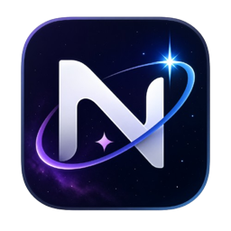
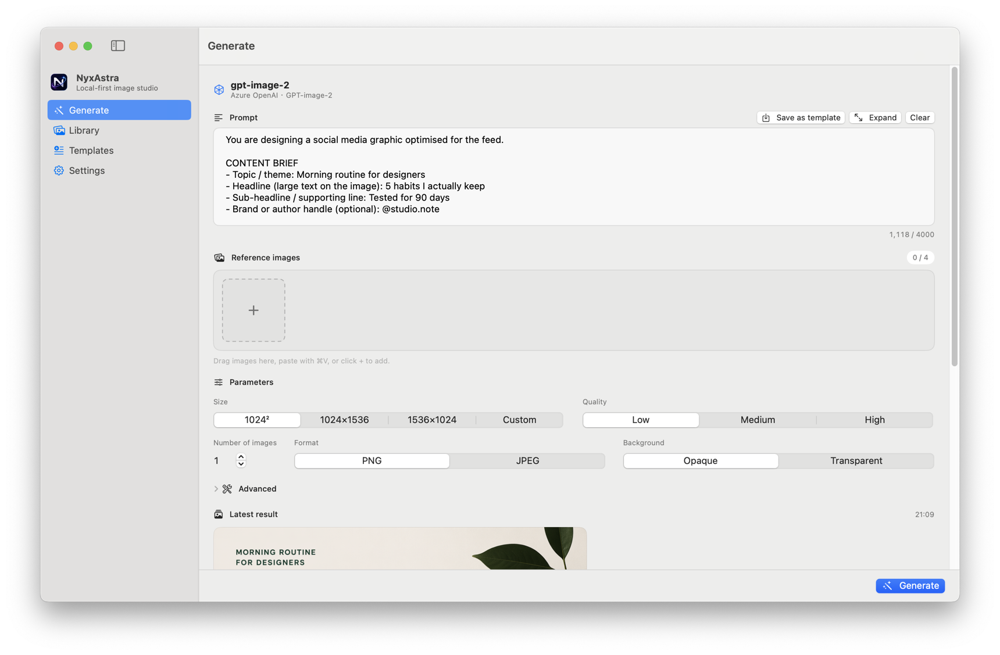
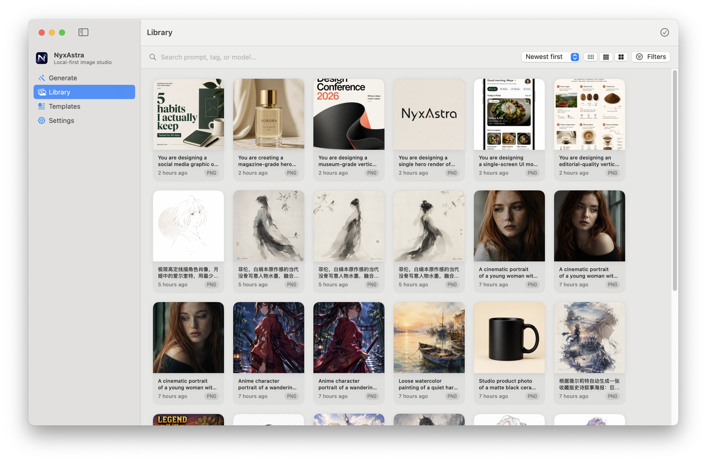
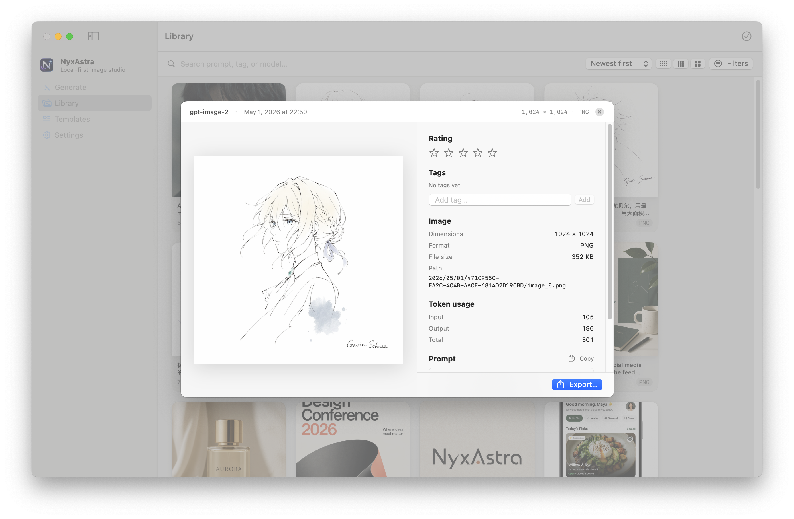
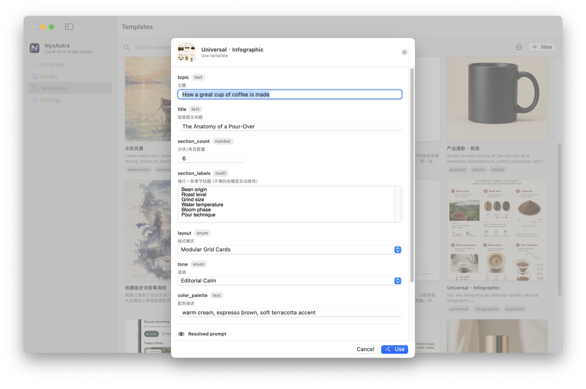
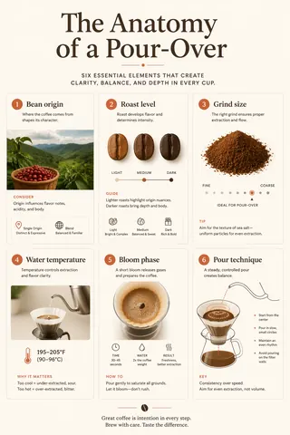
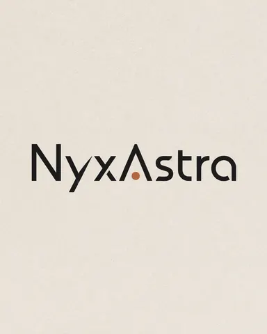
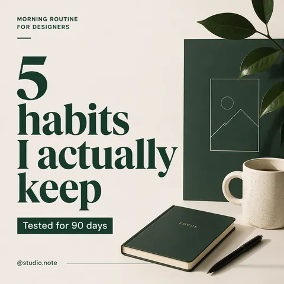
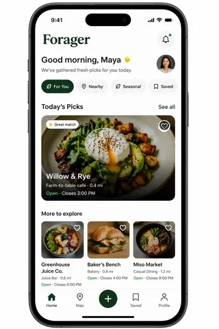

  

<h1 align="center">NyxAstra</h1>

  <strong>The AI image studio that stays on your device.</strong> 
  Native on Mac, iPhone, iPad, and Windows — your key, local image and template storage.

  
  &nbsp;&nbsp;
  
  &nbsp;&nbsp;
  
  &nbsp;&nbsp;
  

  
  
  
  
  
  
  
  

---

  <video src="assets/demo.mp4" width="720" autoplay loop muted playsinline>
    
  </video>

  

## Why NyxAstra?

Most AI image tools lock you into a web app, charge monthly fees, and route everything through their servers. **NyxAstra is different:**

- **Your API key, your control.** Connect your own OpenAI or Azure OpenAI account. No middleman, no markup.
- **Local-first by design.** Zero telemetry and zero analytics. Credentials, history, templates, and generated images stay on-device; generation content is sent directly to the OpenAI or Azure OpenAI endpoint you configure.
- **Native across platforms.** SwiftUI on Mac, iPhone, and iPad; WPF and .NET 10 on Windows. Apple layouts adapt from compact iPhone screens to iPad and Mac.
- **Free.** No trials, no feature gates, no subscriptions.

---

## What you can do

### Generate up to 4K images

Control quality, size, format, background and moderation where the selected model supports them. **Mac 1.3.1 (build 17) is available on the App Store.** Model support depends on the platform and release:

| Release | Supported models |
|---|---|
| **Mac 1.3.1** | OpenAI: `gpt-image-2.6-flare`, `gpt-image-2.6-sunburst`, plus earlier models. Azure retains the earlier model choices. |
| **Mac / iPhone / iPad v1.1 baseline** | `gpt-image-2.5-sunburst`, `gpt-image-2.5-flare`, `gpt-image-2`, `gpt-image-1.5`, `gpt-image-1`, `gpt-image-1-mini` |
| **Existing direct-download DMG** | `gpt-image-2`, `gpt-image-1.5`, `gpt-image-1`, `gpt-image-1-mini` |
| **Windows** | `gpt-image-2`, `gpt-image-1.5`, `gpt-image-1`, `gpt-image-1-mini` |

Mac 1.3.1 adds GPT Image 2.6 through **OpenAI**, including six quality levels and up to 16 static reference images. The Mac update does not announce a new iPhone/iPad, direct DMG or Windows release. The existing GitHub DMG does not include GPT Image 2.5 or 2.6.

### New in Mac 1.3.1

- **SVG graphics:** generate one vector image at a time, preview it and export the original SVG. SVG output uses text prompts without reference images.
- **GIF animations:** generate from text or static reference images. Choose 2–16 frames and 20–2000 ms per frame; frame size defaults to Auto. GIF access depends on your OpenAI account's preview permission.
- **Complexity:** choose Low, Medium or High planning effort independently of rendering quality.
- **Clearer controls:** format, size, quality and Complexity are directly accessible; narrower windows wrap the options. GIF controls appear when needed.
- **Template compatibility:** downloaded Discover example presets retain their quality, Complexity and animation settings.

See the [1.3.1 release notes](RELEASE_NOTES.md).

  

### Edit with reference images

Drag & drop reference images to guide the AI. Perfect for style transfer, variations, and iterative refinement.

### Organize everything in the Library

Tag, rate, search, filter and batch export. Generation history keeps the prompt, parameters, token usage and model. PNG/JPEG exports can embed metadata; SVG/GIF originals preserve their content, with request details retained in local history and adjacent request files.

  

  

### One-click prompt templates

Don't start from a blank prompt. NyxAstra ships with **12 curated templates** covering universal briefs (poster, infographic, logo, UI mockup, product hero, social post) plus six recipe-style starters — cinematic portraits, pixel art, watercolor landscapes, product photography, minimal logo, and an editorial narrative poster. Each template has **fill-in variables** — just type your subject and hit Generate.

  

**Browse Community Templates → [gavinschneestudio.org/nyxastra/templates](https://gavinschneestudio.org/nyxastra/templates/)**

Community Templates is the public website for free sharing and contributions, including the official starter pack and community submissions. Each template credits its author and carries its own license. Download a `.nyxtemplate` file from its detail page. On Mac, iPhone, or iPad, open the file with NyxAstra to import it. On Windows, import it from the Templates workspace with the import button.

SVG and GIF recipes need a client that supports their template version and output format. Existing v2 downloads keep their version; SVG recipes use v3 and GIF recipes use v4. Covers remain static PNG/JPEG/WebP previews.

**Discover** is the separate curated catalog inside NyxAstra for Mac, for official releases and approved creators. It includes free and paid templates, with purchases and recovery in the Mac App Store edition. Open it from the Discover sidebar entry. The globe button in **Templates** opens Community Templates on the web; Templates remains your personal workspace for using, editing and organizing files from either source. Image-generation fees are separate from template downloads or purchases.

| | | |
|:---:|:---:|:---:|
|  |  |  |
| Event Poster | Infographic | Logo Concept |
|  |  |  |
| Product Hero Shot | Social Media Post | UI Mockup |

---

## Contribute your templates

NyxAstra templates are shareable `.nyxtemplate` files — and **everyone is welcome to contribute**. The full guide lives in [`community/CONTRIBUTING.md`](community/CONTRIBUTING.md); the short version:

1. **Design** a prompt in NyxAstra with `{{variables}}`
2. **Fill in the *Community Sharing* section** in the template editor (author, license, category)
3. **Export** it — right-click the template, choose *Export…*
4. **Submit** it — open a Pull Request that drops the file into [`community/templates/`](community/templates/), or [open a submission issue](https://github.com/GavinHarbus/nyxastra-app/issues/new?template=template_submission.yml) and a maintainer will help.

CI lints the file in a single round; a maintainer reviews, merges, and the next push to `main` rebuilds the gallery — credited to you under the license you choose.
Community contributions are free to download and do not require approved-creator status. Inclusion in the app's Discover catalog is a separate selection process; a community submission does not automatically publish there.

---

## Privacy — by design, not by promise

| | |
|---|---|
| **Network** | Generation requests go to the OpenAI / Azure endpoint *you* configure. The Mac app also uses NyxAstra services for optional accounts and Discover, and Apple services for App Store purchases. |
| **Credentials** | Stored locally: AES-256-GCM on macOS, Windows DPAPI on Windows, and the device-only system Keychain on iPhone and iPad. |
| **Storage** | App data stays on your device: the macOS app sandbox, `%LOCALAPPDATA%\NyxAstra` on Windows, or the local app container on iPhone and iPad. |
| **Telemetry** | None. No analytics, no crash reporting, no phone-home. |
| **Backend** | The Mac app uses a NyxAstra backend for accounts, curated template delivery and purchase verification. Image generation remains with your chosen provider. |

Read the current [NyxAstra Privacy Policy](https://gavinschneestudio.org/nyxastra/privacy.html).

---

## Getting started

### macOS

NyxAstra is available from the [App Store](https://apps.apple.com/us/app/nyxastra/id6804567608?mt=12) in supported regions. The existing direct DMG remains available for other regions, including mainland China; it is an earlier preview and does not include GPT Image 2.5 or 2.6.

1. **Download** the earlier preview `.dmg` from [macOS Releases](https://github.com/GavinHarbus/nyxastra-app/releases)
2. **Drag** NyxAstra to your Applications folder
3. **Open** NyxAstra and go to Settings
4. **Paste** your OpenAI or Azure OpenAI API key
5. **Generate** your first image

> **macOS requirements:** macOS 14.0 (Sonoma) or later, Apple Silicon or Intel Mac, your own API key from [OpenAI](https://platform.openai.com/) or [Azure OpenAI](https://azure.microsoft.com/en-us/products/ai-services/openai-service).

### Windows

1. **Download** the latest Windows `.zip` from [Windows Releases](https://github.com/bbkgl/NyxAstraApp-Win/releases)
2. **Extract** the package
3. **Run** the top-level `NyxAstra.exe` and keep the bundled `app` folder next to it
4. **Open** Settings and paste your OpenAI or Azure OpenAI API key
5. **Generate** your first image

> **Windows requirements:** Windows x64 and your own API key from [OpenAI](https://platform.openai.com/) or [Azure OpenAI](https://azure.microsoft.com/en-us/products/ai-services/openai-service). The release package is self-contained and includes the bundled .NET/WPF runtime; you do not need the .NET SDK to run it.

### iPhone and iPad

Install NyxAstra from the [App Store](https://apps.apple.com/us/app/nyxastra/id6804567608?mt=12). The universal Apple app requires iOS/iPadOS 17 or later and uses layouts tailored to both iPhone and iPad.

---

## Credits

Special thanks to [@bbkgl](https://github.com/bbkgl) for building the WPF/.NET Windows port of NyxAstra and publishing the Windows releases for users.

---

## More

- [Community Templates](https://gavinschneestudio.org/nyxastra/templates/) — free downloads, author credits and community contributions
- [App Store](https://apps.apple.com/us/app/nyxastra/id6804567608?mt=12) — Mac, iPhone, and iPad in supported regions
- [Community contributing guide](community/CONTRIBUTING.md) — submit your own templates
- [Windows Releases](https://github.com/bbkgl/NyxAstraApp-Win/releases) — download the Windows build
- [Release notes](RELEASE_NOTES.md) — Mac 1.3.1 features and platform availability
- [FAQ](FAQ.md) — common questions answered
- [Privacy Policy](https://gavinschneestudio.org/nyxastra/privacy.html) — the current full details
- [Product Page](https://gavinschneestudio.org/products/nyxastra.html)

## Feedback & Support

Found a bug? Have an idea? [Open an issue](https://github.com/GavinHarbus/nyxastra-app/issues/new/choose) — every report helps make NyxAstra better.

---

  Made by <a href="https://gavinschneestudio.org/">Gavin Schnee Studio</a> 
  &copy; 2026 Gavin Schnee Studio. All Rights Reserved.

